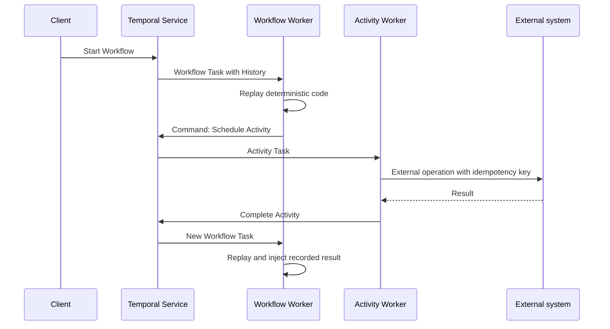
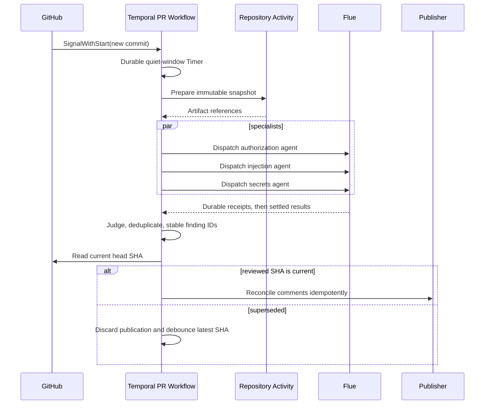

# Architecture Walkthrough

The repository contains two layers of learning:

1. A subscription workflow implemented with Temporal and with a DIY PostgreSQL/RabbitMQ orchestrator.
2. A stateful multi-agent PR-review workflow that combines Temporal lifecycle orchestration with Flue agent submissions.

## Temporal application path

The Temporal Service executes neither Workflow nor Activity application code. Application Workers poll Task Queues. Workflow Workers reconstruct state and emit Commands. Activity Workers perform I/O.

## What is persisted

Temporal persists ordered Event History and service-managed mutable state. History contains Workflow inputs, Activity scheduling and results, Timers, Signals, and terminal Events. It does not contain every local assignment or every JavaScript `await`.

Sticky execution may cache a Workflow's in-memory state on a Worker for speed. The cache is disposable. History remains authoritative.

## DIY path

See [DIY Orchestrator Architecture](diy-architecture.md). Its explicit state column plays the role of a program counter. RabbitMQ transports ready work. PostgreSQL stores timers, delayed retries, locks, attempts, and repair state.

## Multi-agent path

Read [Building Stateful Multi-Agent Systems with Temporal and Flue](flue-temporal-agentic-harness.md) for state ownership, cancellation, crash windows, Continue-As-New, security boundaries, and evaluation design.

## Guarantee boundaries

| Boundary | Guarantee | Remaining responsibility |
|---|---|---|
| Workflow replay | Deterministically reconstruct logical state | Version Workflow code safely |
| Completed Activity in History | Replay reuses the result | In-flight Activity may execute again |
| Activity retry | Durable retry scheduling | Idempotent external effects |
| Signal | Durable message in History | Application event IDs for logical duplicates |
| Flue admission | One durable terminal outcome for admitted submission | Make dispatch admission retry-safe |
| Flue `read(receipt)` | Reattach to submission state | Persist receipt before later steps |
| Flue durable tool | Completed `step.do` results replay | Step function may execute more than once |
| GitHub publication | None automatically | Stable IDs, freshness check, reconciliation |
