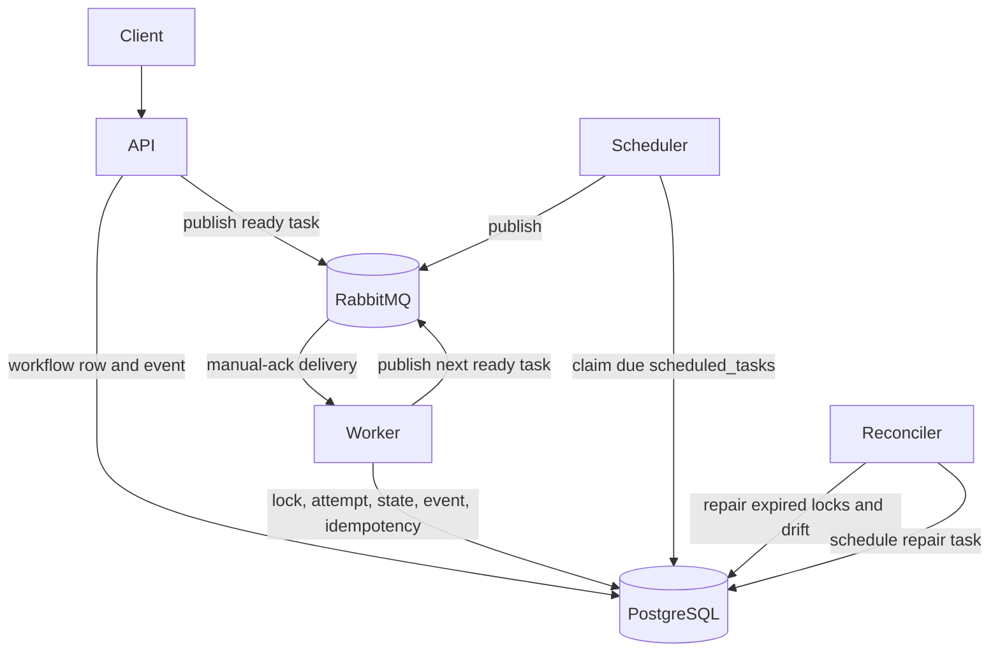

# DIY Orchestrator Architecture

The DIY implementation uses PostgreSQL for authoritative workflow state and delayed tasks, plus RabbitMQ for ready-task delivery.



## PostgreSQL tables

| Table | Purpose |
|---|---|
| `subscription_workflows` | Authoritative current state and timer deadline |
| `workflow_events` | Append-only audit log; unlike Temporal History, not used for replay |
| `activity_attempts` | Attempt status and results |
| `idempotency_keys` | Completed-task result cache |
| `workflow_locks` | One consumer advancing a workflow at a time |
| `scheduled_tasks` | Durable delayed retries and repair publications |
| `dead_letter_tasks` | Exhausted work requiring operator action |

## Normal task execution

```text
RabbitMQ delivers message without removing it
  -> Worker acquires PostgreSQL workflow lock
  -> Worker validates current state
  -> Worker checks idempotency record
  -> Worker records RUNNING attempt
  -> Worker executes external operation
  -> transaction records result, state transition, event, idempotency record
  -> Worker publishes next task
  -> Worker acknowledges current RabbitMQ message
```

RabbitMQ acknowledgement protects against consumer loss, but it does not make external effects exactly once. A Worker can perform an effect and die before the idempotency record commits.

## Delayed retries

RabbitMQ carries ready work. PostgreSQL carries future work:

```text
Activity fails
  -> Worker records failed attempt
  -> Worker inserts scheduled_tasks(execute_after)
  -> Scheduler claims due rows
  -> Scheduler publishes to RabbitMQ
  -> Consumer retries
```

The Scheduler's publish and `published_at` update cross two systems. Duplicate publication remains possible around crashes. Consumers must be idempotent, and a production implementation should use publisher confirms plus an outbox-oriented relay and reconciliation.

## Reconciler

The Reconciler is a backstop. It removes expired locks and finds non-terminal states that have not advanced. It creates durable repair work in `scheduled_tasks`.

RabbitMQ redelivery is the primary response to a dead consumer. The Reconciler handles state/queue drift that message acknowledgement alone cannot repair.

## Important limitations

This code is intentionally small enough to study. It omits replication, shard ownership, visibility indexing, sophisticated outbox semantics, versioned state-machine migrations, namespace isolation, archival, encryption codecs, and multi-cluster recovery.

Those omissions are why the repository says the DIY version approximates this example rather than reproducing Temporal.

